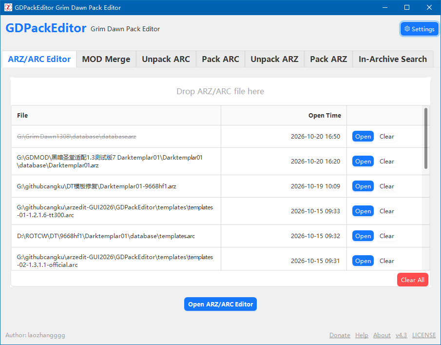
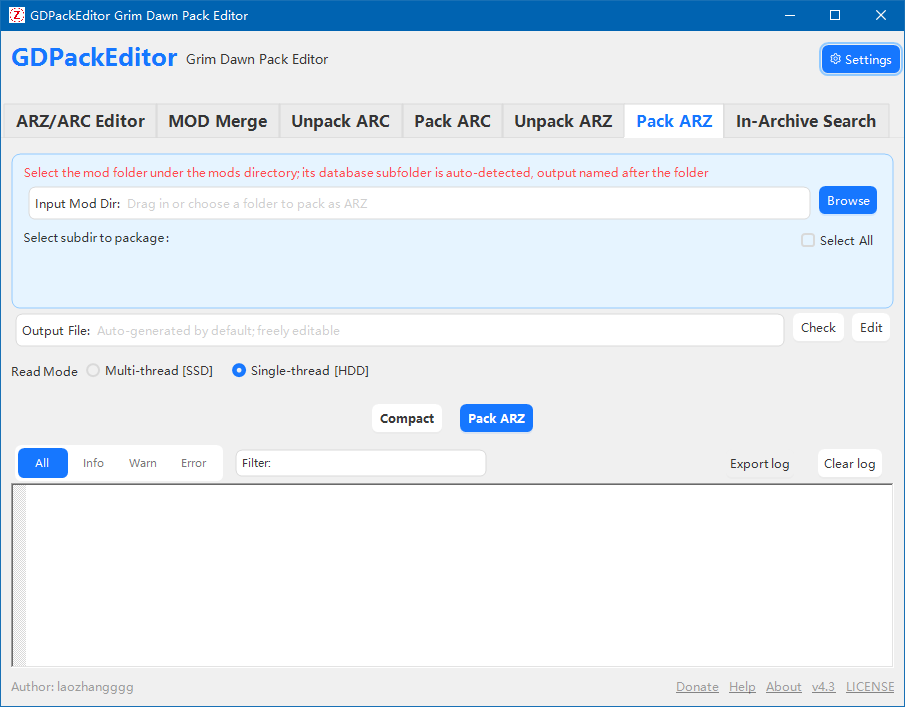
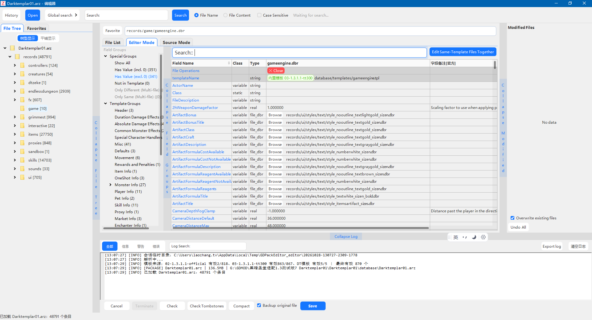
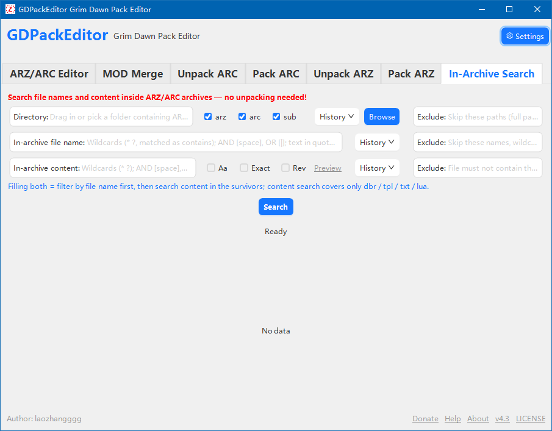
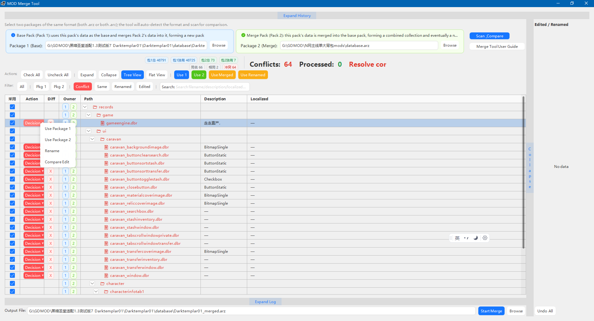
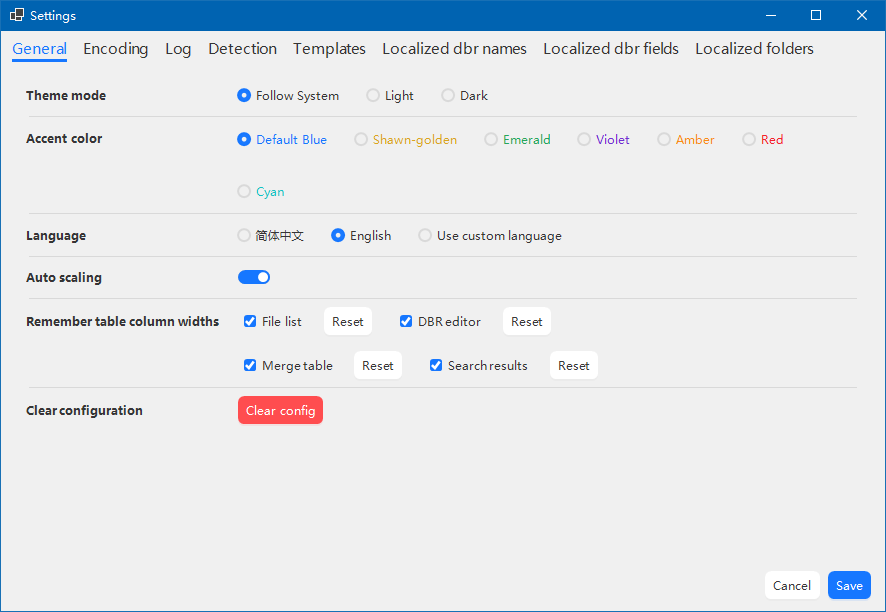
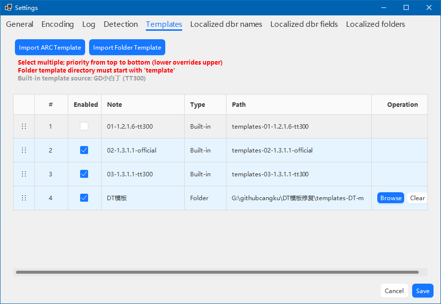
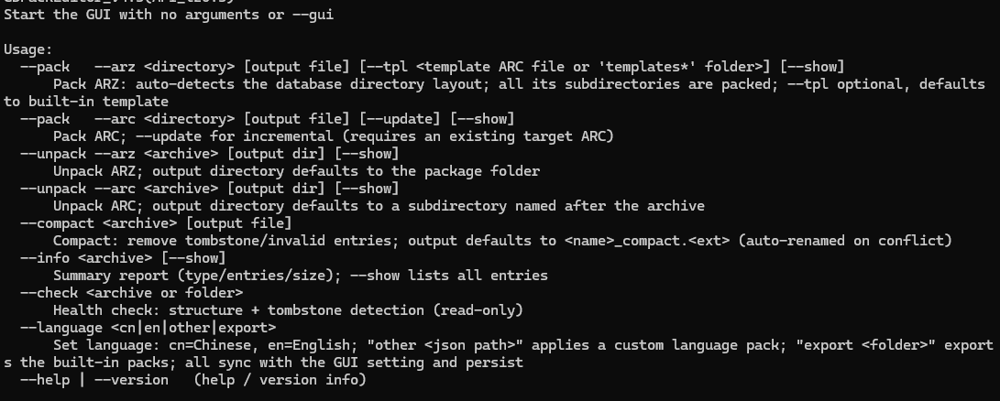

# GDPackEditor

English | [简体中文](README.md)

A graphical tool for Grim Dawn ARZ / ARC package files: unpack, pack, solid-pack, in-package editing, and MOD merging.

This project is the successor to [arzedit-GUI](https://github.com/zhangqi222/arzedit-GUI). The original project is no longer maintained, and this project includes all of its capabilities.

> Unofficial community tool. Not affiliated with or endorsed by Crate Entertainment.

## What it is

GDPackEditor is a Windows desktop tool for Grim Dawn MOD authors. It turns command-line ARZ/ARC package operations into a visual workflow and adds in-package editing, template assistance, localization helpers, and MOD diff/merge support.

The tool works in memory and a temporary directory. **The original package is not modified until you save**; the final result is written to a new package.

## Features

- **ARZ / ARC unpack**: extract by directory while preserving original in-package timestamps.
- **ARZ / ARC pack**: normal, solid, incremental update, and overwrite.
- **In-package editor**: browse, search, and edit files without a full unpack first; import, mark for deletion, batch edit, and save.
- **DBR assistance**: template field hints, field notes, batch value/formula editing, and same-template multi-file editing.
- **In-package search**: combine directory, file name, and content filters; wildcard syntax, case sensitivity, exact match, exclusions, and localized-name reverse lookup.
- **MOD merge**: compare two ARZ/ARC packages, review structural and content differences, and merge selected items into a new package.
- **Template system**: built-in official templates, multiple sources with source labels.
- **Localization helpers**: import game language packs, show localized names, and reverse-lookup tags by translated names.
- **Bilingual UI**: Simplified Chinese and English.
- **CLI**: command-line usage is retained for scripting.

## Screenshots

| Main window | Pack ARZ |
| --- | --- |
|  |  |

| ARZ/ARC editor | In-package search |
| --- | --- |
|  |  |

| MOD merge | Settings |
| --- | --- |
|  |  |

| Template selection | Command line |
| --- | --- |
|  |  |

## Requirements

- Windows 10 / 11, 64-bit
- [.NET 8 Desktop Runtime](https://dotnet.microsoft.com/download/dotnet/8.0) (for the framework-dependent build)
- Windows only; the UI is built with WinForms + AntdUI

> This version targets .NET 8. Microsoft's support for .NET 8 ends on 2026-11-10; an upgrade will be evaluated separately.

## Download and run

1. Download the latest `GDPackEditor.exe` and `SHA256SUMS.txt` from [Releases](../../releases).
2. Verify the file (optional):

   ```powershell
   Get-FileHash .\GDPackEditor.exe -Algorithm SHA256
   ```

3. Run the executable. Configuration and logs are created in your user profile on first launch.

> Official builds are **not code-signed**. Windows SmartScreen or antivirus software may warn or produce a false positive. Download only from this repository's Releases and verify the SHA-256.

## Build

Development build (default output under `bin`):

```powershell
dotnet build
```

Single-file publish (Windows x64, framework-dependent):

```powershell
dotnet publish GDPackEditor/GDPackEditor.csproj -c Release -r win-x64 --self-contained false -p:PublishSingleFile=true
```

The output is written to `GDPackEditor/bin/Release/net8.0-windows/win-x64/publish/`.

## Usage

See the full user guide (Simplified Chinese): [GDPackEditor_wiki_user.md](GDPackEditor_wiki_user.md).

Back up your saves and package files before editing. The tool tries to preserve the original package structure and data, but any modification carries risk.

## Localization and dictionary

- The UI supports Simplified Chinese and English.
- `GDPackEditor/dict/DbrKeyMapping_cn.txt` is a machine-translated field-name dictionary, provided **for reference only** and without any accuracy guarantee.
- Field names and descriptions in game templates follow the original game data.

## License

- Original code of this project is licensed under the [MIT License](LICENSE).
- Upstream arzedit, third-party NuGet components, and game templates are **not** covered by the MIT grant; their original rights and licenses apply. See [LICENSE](LICENSE) and [THIRD-PARTY-NOTICES.md](THIRD-PARTY-NOTICES.md).
- Built-in templates are copyright **Crate Entertainment**.

## Credits

- **WillSo / arzedit**: ARZ/ARC parsing approach and derived code.
- **Ridwan Hidayatullah / gd-utility**: reference for Grim Dawn reverse engineering.
- **TT300**: template organization.
- **Crate Entertainment**: Grim Dawn and its game data.
- All third-party open-source authors.

## Disclaimer

This is a non-profit personal project provided "as is", without any express or implied warranty. The author is not liable for save corruption, game malfunction, data loss, or other damage caused by using this tool. Back up your data first.

If any content in this project infringes your rights, please let me know and I will handle it in accordance with the rights holder's wishes.
