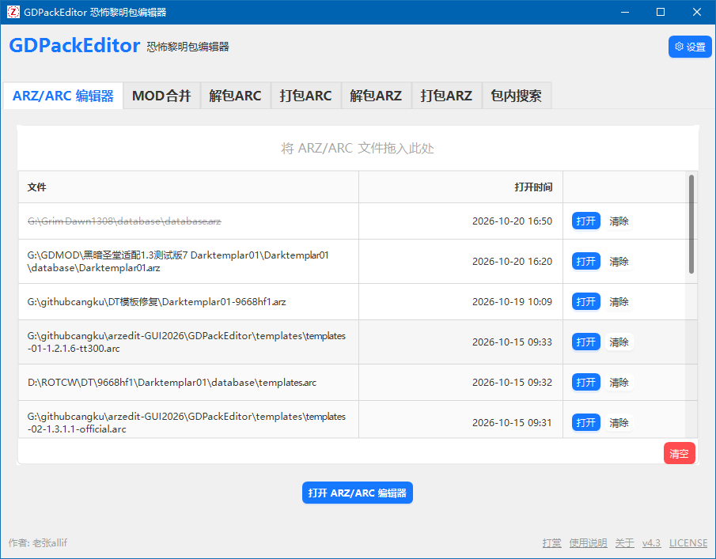
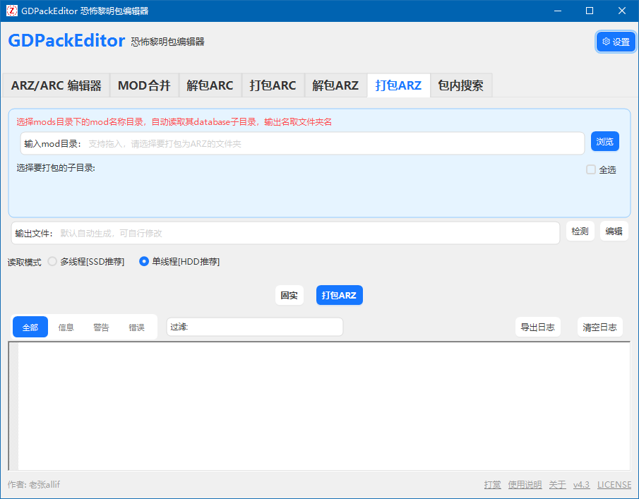
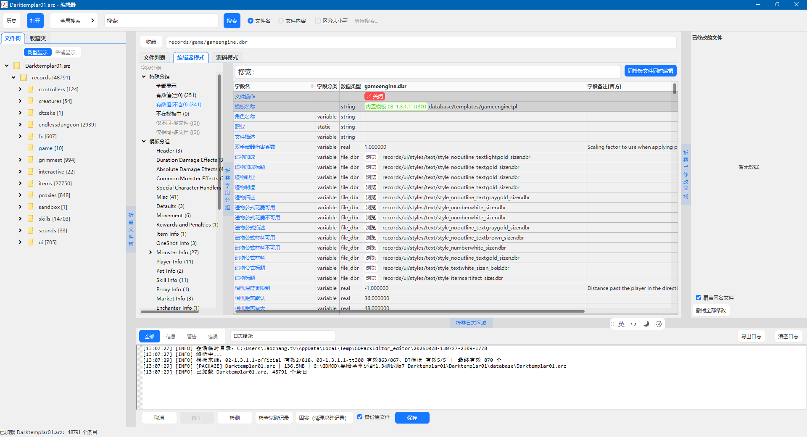
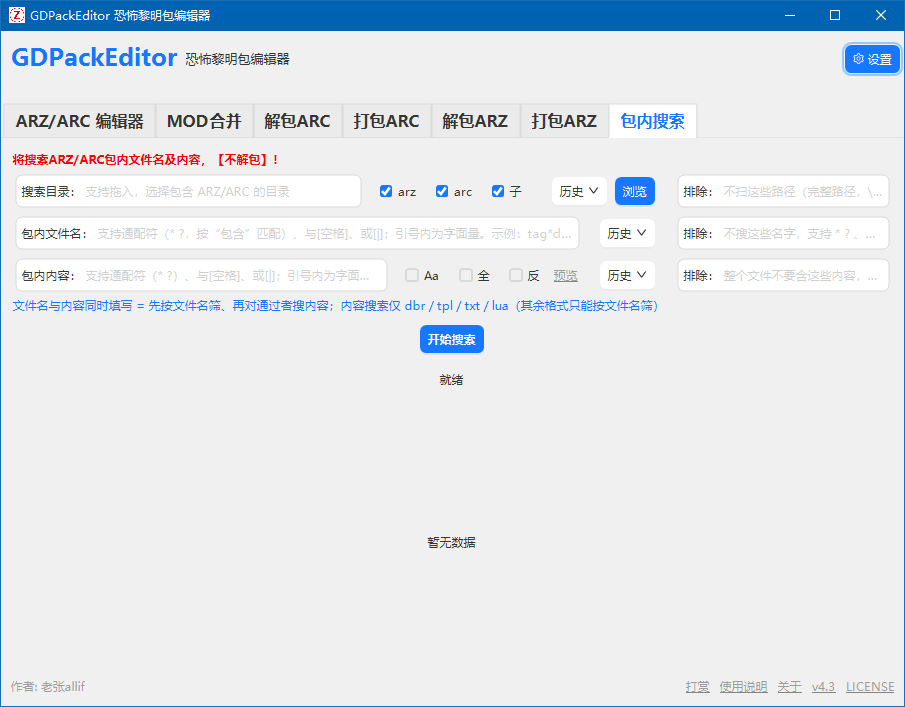
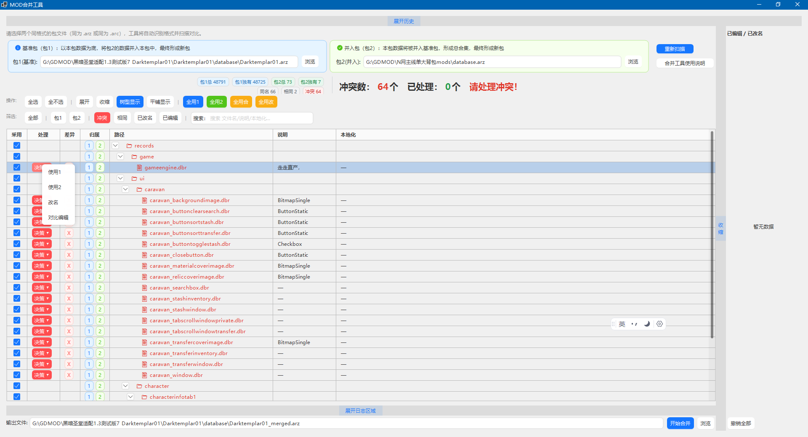
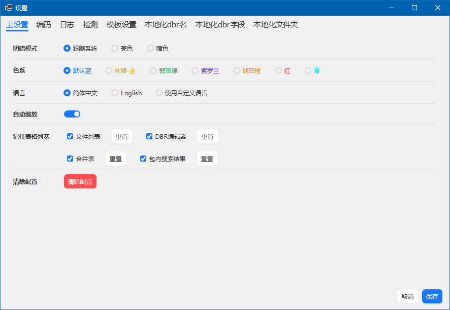
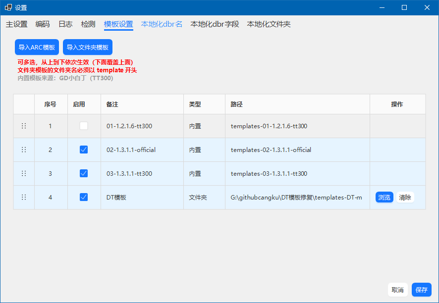
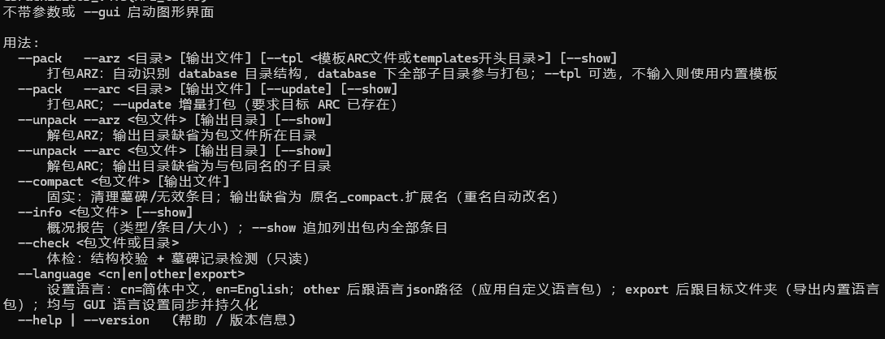

# GDPackEditor

[English](README-EN.md) | 简体中文

《恐怖黎明》（Grim Dawn）ARZ / ARC 包文件编辑工具，带图形界面，支持解包、打包、固实、包内编辑与 MOD 合并。

本项目前身：[arzedit-GUI](https://github.com/zhangqi222/arzedit-GUI)，原项目已不再维护，本项目包含原项目的全部能力。

> 非官方社区工具，与 Crate Entertainment 无隶属或背书关系。

## 项目定位

GDPackEditor 是一个面向《恐怖黎明》MOD 制作者的 Windows 桌面工具。它把原本依赖命令行的 ARZ/ARC 包操作做成可视化界面，并在此基础上提供包内文件编辑、模板辅助、本地化辅助和 MOD 差异合并等能力。

工具只在内存和临时目录中处理数据，**保存前不会改动原始包文件**；最终打包时再把操作结果写入新包。

## 主要功能

- **ARZ / ARC 解包**：按目录解出包内文件，保留包内原始时间戳。
- **ARZ / ARC 打包**：支持普通打包、固实（solid）打包、增量更新与同名覆盖。
- **包内编辑器**：不先完整解包也能浏览、搜索、编辑包内文件；支持导入、删除标记、批量编辑与保存。
- **DBR 辅助**：模板字段提示、字段备注、批量数值/公式编辑、同模板多文件编辑。
- **包内搜索**：按目录、文件名、内容组合搜索；支持通配符、正则式写法、区分大小写、完全匹配、排除条件与本地化反查。
- **MOD 合并**：对比两个 ARZ/ARC 的结构与内容差异，勾选后合并到新包。
- **模板系统**：内置官方模板包，支持多来源叠加与来源标记。
- **本地化辅助**：导入游戏语言包，显示本地化名称，支持按译名反查 tag。
- **中英文界面**：内置简体中文 / English，可跟随设置切换。
- **CLI**：保留命令行用法，便于脚本化处理。

## 界面截图

| 主界面 | 打包 ARZ |
| --- | --- |
|  |  |

| ARZ/ARC 编辑器 | 包内搜索 |
| --- | --- |
|  |  |

| MOD 合并 | 设置 |
| --- | --- |
|  |  |

| 模板选择 | 命令行 |
| --- | --- |
|  |  |

## 运行环境

- Windows 10 / 11，64 位
- [.NET 8 Desktop Runtime](https://dotnet.microsoft.com/download/dotnet/8.0)（框架依赖版需要）
- 仅支持 Windows；界面基于 WinForms + AntdUI

> 当前版本基于 .NET 8。微软对 .NET 8 的支持将于 2026-11-10 结束，后续是否升级另行评估。

## 下载与运行

1. 从 [Releases](../../releases) 下载最新的 `GDPackEditor.exe` 与 `SHA256SUMS.txt`。
2. 校验文件（可选）：

   ```powershell
   Get-FileHash .\GDPackEditor.exe -Algorithm SHA256
   ```

3. 双击运行。首次启动会在用户目录下创建配置与日志。

> 官方版本**未做代码签名**，Windows SmartScreen 或杀毒软件可能提示风险或误报。请只从本仓库 Releases 下载，并核对 SHA-256。

## 构建

开发构建（默认输出到 `bin`）：

```powershell
dotnet build
```

单文件发布（Windows x64、框架依赖）：

```powershell
dotnet publish GDPackEditor/GDPackEditor.csproj -c Release -r win-x64 --self-contained false -p:PublishSingleFile=true
```

发布产物位于 `GDPackEditor/bin/Release/net8.0-windows/win-x64/publish/`。

## 使用说明

完整操作说明见 [GDPackEditor_wiki_user.md](GDPackEditor_wiki_user.md)。

建议先备份存档和待修改的包文件。工具会尽量保持原始包结构与数据不变，但任何修改类工具都存在风险。

## 本地化与字典

- 界面支持简体中文与 English。
- `GDPackEditor/dict/DbrKeyMapping_cn.txt` 为机器翻译的字段名字典，**仅供参考**，不保证准确性。
- 模板中的字段名、说明以游戏原始数据为准。

## 许可

- 本项目**原创代码**采用 [MIT License](LICENSE)。
- 上游 arzedit、第三方 NuGet 组件、游戏模板等**不属于 MIT 授权范围**，分别遵循其原始权利与许可，详见 [LICENSE](LICENSE) 与 [THIRD-PARTY-NOTICES.md](THIRD-PARTY-NOTICES.md)。
- 内置模板版权归 **Crate Entertainment（板条箱）** 所有。

## 致谢

- **WillSo / arzedit**：ARZ/ARC 数据解析思路与部分衍生代码。
- **Ridwan Hidayatullah / gd-utility**：对《恐怖黎明》整体逆向的参考。
- **TT300**：整理内置模板。
- **Crate Entertainment**：《恐怖黎明》及游戏数据版权方。
- 所有第三方开源组件的作者。

## 免责声明

本工具为个人非盈利作品，按“现状”提供，不提供任何明示或暗示担保。因使用本工具造成的存档损坏、游戏异常、数据丢失或其它损失，作者不承担责任。使用前请自行备份。
